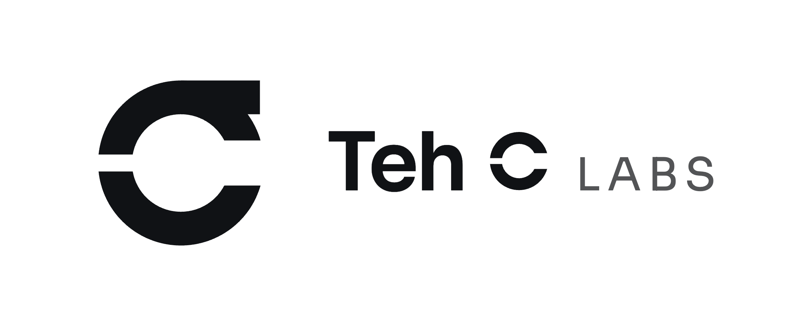

<picture>
  <source media="(prefers-color-scheme: dark)" srcset="teh-c-labs-lockup-dark.png">
  
</picture>

**Crafted around the people who use it.**

Teh C Labs is a software design studio in Kuala Lumpur. We are rarely the
first to solve a problem. We aim to be the first to solve it properly. Every
system starts with a person, so we study how they really work, design around
them, and choose the technology last. Then we build it, run it and keep
refining it.

Status is stated plainly.

| | | |
|---|---|---|
| **[CondoOS](https://condo-os.my)** | Built and running | Condominium operations: billing and collections, complaints, facility bookings, visitors and parcels, maintenance rounds and committee governance. |
| **BarberOS** | In development | Barbershop operations: online booking, the walk-in queue, payment at the counter, customer history and the day's takings. |

Our repositories are private. This one is public because GitHub serves an
organisation's shared issue templates, security policy and profile from a repo
named `.github`, and that repo cannot be private.

- Company site: <https://tehclabs.my>
- Security policy: [SECURITY.md](SECURITY.md)
- Contributing: [CONTRIBUTING.md](CONTRIBUTING.md)
